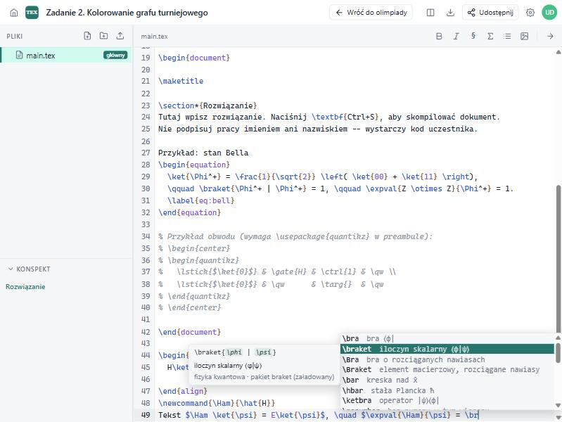

# webTEX

**webTEX** to otwartoźródłowy, samodzielnie hostowany edytor LaTeX-a do pracy zespołowej w czasie rzeczywistym, czyli alternatywa dla Overleaf, którą stawiasz na własnym serwerze. Piszesz w przeglądarce, kompilujesz w izolowanym kontenerze TeX Live i od razu widzisz PDF obok kodu.

*English version below. [Jump to English](#english)*

---

## Funkcje

- **Współpraca w czasie rzeczywistym** oparta na [Yjs](https://yjs.dev): wiele osób edytuje ten sam plik naraz, widać ich kursory i zaznaczenia (z imionami i kolorami), zmiany scalają się bez konfliktów (CRDT).
- **Projekty i pliki**: foldery, tworzenie, zmiana nazwy, przenoszenie i usuwanie plików, wysyłanie plików (obrazy, PDF-y, `.bib`, `.sty`…), import projektu z `.zip` i eksport do `.zip`, kopiowanie projektu. Na start są szablony: pusty artykuł, artykuł po polsku, prezentacja Beamer i raport z bibliografią (biblatex + biber).
- **Udostępnianie linkiem**: osobny link do edycji i do podglądu (tylko odczyt). Właściciel widzi listę członków, może zmienić im rolę, usunąć ich albo unieważnić linki.
- **Kompilacja** silnikami `pdflatex`, `xelatex` i `lualatex` przez `latexmk`, z automatycznym uruchamianiem bibtex/biber i ponownymi przebiegami. Każda kompilacja startuje w świeżym kontenerze Docker **bez dostępu do sieci**, z limitami pamięci, CPU, liczby procesów i czasu.
- **Czytelne logi**: błędy, ostrzeżenia i problemy składu (over/underfull box) wyciągnięte z logu TeX-a, z plikiem i numerem linii. Kliknięcie przenosi do miejsca w kodzie. Pełny log jest też dostępny.
- **SyncTeX w obie strony**: z kodu do PDF-u (podświetla odpowiedni fragment) i z PDF-u do kodu (dwuklik na stronie).
- **Edytor CodeMirror 6**: kolorowanie składni LaTeX-a i BibTeX-a, kontekstowe autouzupełnianie (opis niżej), wyszukiwanie i zamiana, skróty (Ctrl+B, Ctrl+I, Ctrl+/, Ctrl+S kompiluje), sprawdzanie pisowni w przeglądarce.
- **Konspekt dokumentu** (sekcje, rozdziały) z nawigacją, **podgląd PDF** w pdf.js z powiększaniem i dopasowaniem do szerokości, **tryb ciemny**, **interfejs po polsku i angielsku**.

## Szybki start

Wymagania: **Node.js ≥ 22.13** (wbudowany `node:sqlite`) oraz **Docker** (do kompilacji w piaskownicy) albo lokalna instalacja TeX Live z `latexmk`.

### Tryb deweloperski

```bash
npm install
docker build -t webtex-texlive docker/texlive    # pełny TeX Live do kompilacji (~2,8 GB do pobrania, jednorazowo)
```

Następnie:

```bash
npm run dev
```

To polecenie uruchamia naraz API z WebSocketem na http://localhost:3000 (restart po zmianach w `server/`) i Vite na http://localhost:5173, który przekazuje `/api` i `/ws` do :3000. Działa na Windowsie, Linuksie i macOS. Oba procesy można też uruchomić osobno: `npm run dev:server` i `npm run dev:client`.

Otwórz http://localhost:5173 i załóż konto. Pierwsze konto nie ma żadnych specjalnych uprawnień; każdy użytkownik widzi tylko swoje projekty i te udostępnione mu linkiem.

### Produkcja (Node na hoście, kompilacja w Dockerze)

To zalecany wariant, gdy z serwera korzysta więcej osób, bo każda kompilacja jest odizolowana.

```bash
npm ci
npm run build
docker build -t webtex-texlive docker/texlive
COMPILE_BACKEND=docker ALLOW_REGISTRATION=false npm start
```

### Docker Compose (wszystko w jednym kontenerze)

```bash
docker compose up -d --build
```

Aplikacja działa na http://localhost:3000, dane trafiają do wolumenu `webtex-data`. W tym trybie TeX Live jest zainstalowany w kontenerze aplikacji (`COMPILE_BACKEND=local`). Kompilacje są oddzielone od hosta, ale nie od siebie nawzajem (patrz [Bezpieczeństwo](#bezpieczeństwo)).

**Wersja TeX Live.** Oba obrazy (`Dockerfile` i `docker/texlive/Dockerfile`) domyślnie używają **pełnego, bieżącego TeX Live** (`scheme-full` bez dokumentacji i źródeł) z oficjalnych obrazów [`texlive/texlive`](https://hub.docker.com/r/texlive/texlive): wszystkie pakiety CTAN, `biber`, `latexmk`, XeLaTeX, LuaLaTeX. Mniejszy albo przypięty do roku wariant wybierasz argumentem budowania `TEXLIVE_IMAGE`, np. `--build-arg TEXLIVE_IMAGE=texlive/texlive:latest-medium` albo `texlive/texlive:TL2025-historic` (w Compose: `build.args`).

Testy jednostkowe (parser logów, SyncTeX, integracja, adaptery LLM na atrapach dostawców):

```bash
npm test
```

## Konfiguracja

Wszystkie ustawienia to zmienne środowiskowe (szablon: [`.env.example`](.env.example)).

| Zmienna | Domyślnie | Opis |
|---|---|---|
| `PORT` | `3000` | Port HTTP |
| `HOST` | `0.0.0.0` | Adres nasłuchu |
| `DATA_DIR` | `./data` | Katalog na bazę SQLite, pliki projektów i wyniki kompilacji |
| `ALLOW_REGISTRATION` | `true` | `false` blokuje zakładanie nowych kont |
| `SECURE_COOKIES` | `false` | `true` dodaje flagę `Secure` do ciasteczka sesji (przy HTTPS) |
| `MAX_UPLOAD_MB` | `50` | Maksymalny rozmiar wysyłanego pliku lub importowanego `.zip` |
| `COMPILE_BACKEND` | `auto` | `auto` (lokalny `latexmk`, a jeśli go nie ma, to Docker), `local` albo `docker` |
| `COMPILE_IMAGE` | `webtex-texlive` | Obraz Dockera używany do kompilacji |
| `COMPILE_TIMEOUT` | `90` | Limit czasu jednej kompilacji w sekundach |
| `COMPILE_MEMORY` | `1g` | Limit pamięci kontenera kompilacji (tylko `docker`) |
| `COMPILE_CPUS` | `2` | Limit CPU kontenera kompilacji (tylko `docker`) |

Za reverse proxy (nginx, Caddy) trzeba przepuścić WebSockety na ścieżce `/ws/` i ustawić `SECURE_COOKIES=true`, jeśli serwujesz przez HTTPS.

## Architektura

```
client/            frontend (Vite, bez frameworka): CodeMirror 6, y-codemirror.next, pdf.js
server/
  index.js         Express 5 + serwer HTTP, statyczne pliki klienta, podpięcie WebSocketów
  config.js        konfiguracja ze zmiennych środowiskowych, ścieżki do danych
  db.js            SQLite (node:sqlite): users, sessions, projects, members, entities
  auth.js          rejestracja, logowanie (scrypt), sesje w ciasteczku httpOnly
  projects.js      REST API: projekty, pliki, udostępnianie, kompilacja, SyncTeX, zip
  tree.js          drzewo plików (encje w SQLite, treść w Y.Doc, pliki binarne na dysku)
  collab.js        serwer Yjs: jeden Y.Doc na projekt, protokół sync + awareness
  compiler.js      latexmk lokalnie albo w kontenerze Docker, kolejka per projekt
  logParser.js     parser logu TeX-a: błędy, ostrzeżenia, stos plików
  synctex.js       parser SyncTeX: wyszukiwanie w przód i wstecz
  templates.js     szablony nowych projektów (także szablon rozwiązania olimpiady)
  integration.js   integracja z platformą olimpiady: SSO, build, sharing, health
  integrationCrypto.js  JWT HS256, podpisy żądań, wyprowadzanie kluczy (czyste funkcje, testowane)
  tex/biber-guard.pl    nakładka na biber blokująca źródła spoza projektu
  tex/sandbox.pl        piaskownica Landlock dla kompilacji w trybie local
docker/texlive/    obraz piaskownicy z pełnym TeX Live (texlive/texlive:latest-full)
scripts/integration-smoke.mjs  test end-to-end integracji na działającym serwerze
```

**Model danych.** Drzewo plików (`entities`: folder, `doc` albo `file`) jest przechowywane w SQLite. Treść każdego dokumentu tekstowego to `Y.Text` w mapie `texts` w jednym `Y.Doc` na projekt, z kluczem równym id encji. Pliki binarne leżą na dysku. Pliki tekstowe wysłane przez użytkownika (`.tex`, `.bib`, `.sty`, `.cls`, …, poprawny UTF-8, do 2 MB) stają się edytowalnymi dokumentami, a pozostałe plikami binarnymi.

**Układ katalogu danych:**

```
data/
  webtex.db                        SQLite (WAL)
  projects/<id>/ydoc.bin           stan Y.Doc (zapis z opóźnieniem ~1,5 s)
  projects/<id>/blobs/<entityId>   pliki binarne
  compiles/<id>/                   katalog roboczy kompilacji (pliki projektu + pliki pomocnicze)
  outputs/<id>/<buildId>/          output.pdf, output.synctex.gz, output.log, latexmk.txt (trzy ostatnie buildy)
```

**Protokół współpracy.** WebSocket `/ws/projects/:id`, uwierzytelniony ciasteczkiem sesji i sprawdzaniem nagłówka `Origin`. Ramki binarne niosą standardowe wiadomości `y-protocols`: typ `0` to sync (step1/step2/update), typ `1` to awareness (kursory, obecność). Ramki tekstowe JSON niosą zdarzenia serwera, na przykład `{type:"tree"}` (zmiana drzewa plików) i `{type:"project"}` (nazwa, silnik, plik główny). Serwer odrzuca aktualizacje od użytkowników z rolą `viewer`. Dokument jest zwalniany z pamięci minutę po rozłączeniu ostatniego klienta.

**Autouzupełnianie.** Podpowiedzi działają w całości w przeglądarce, bez sieci i bez wysyłania treści. Logika jest w czystych modułach `client/src/editor/latex/` (testy w `client/test/`), a `client/src/editor/completions.js` podpina ją do `@codemirror/autocomplete`.



- **Komendy z opisem i szablonem** (`catalog.js`): ok. 380 komend i 60 środowisk z krótkim opisem po polsku (po angielsku przy interfejsie EN), kategorią i pakietem. Komendy z argumentami wstawiają się jako snippety z polami: `\frac{a}{b}`, `\braket{\phi | \psi}`; Tab przechodzi do następnego pola. `\begin{…}` wstawia od razu pasujące `\end{…}`, a Enter po ręcznie wpisanym `\begin{nazwa}` dopisuje `\end{nazwa}`, jeśli środowisko nie jest już zamknięte.
- **Kontekst** (`context.js`): w trybie matematycznym (`$…$`, `\(…\)`, `\[…\]`, `equation`, `align`, …; `\text{…}` wraca do tekstu) podpowiadane są symbole, litery greckie, operatory i notacja kwantowa (`braket`, `physics`: `\ket`, `\expval`, `\comm`, `\dv`, …), poza nim komendy tekstowe. Komendy drugiego trybu pojawiają się na końcu listy dopiero od dwóch liter po `\`. `\item` tylko w listach, komendy `quantikz` tylko w obwodzie. Po `\begin{` nazwy środowisk (macierze i `cases` we wzorze), po `\end{` najpierw środowisko do zamknięcia, po `\ref{`/`\eqref{` etykiety z plikiem, wierszem i fragmentem źródła, po `\label{` prefiks (`eq:`, `fig:`, `tab:`, `sec:`), po `\usepackage{` pakiety z opisem. W komentarzach i `verbatim` podpowiedzi są wyłączone. Analiza kontekstu czyta tylko ograniczony fragment przed kursorem (od ostatniej pustej linii, maks. 20 tys. znaków; otwarte środowiska z maks. 100 tys.).
- **Definicje z projektu** (`scan.js`): `\newcommand`, `\renewcommand`, `\providecommand`, `\def`, `\DeclareMathOperator`, `\DeclarePairedDelimiter`, `\NewDocumentCommand` (z liczbą argumentów), `\newenvironment`, `\newtheorem`, `\label`, `\bibitem`, klucze `.bib` i wczytane pakiety. Wynik jest buforowany per plik i liczony od nowa tylko po zmianie pliku. Komendy z pakietu, którego projekt nie wczytuje, mają w opisie „wymaga `\usepackage{…}`” i niższą pozycję.
- **Ranking** (`rank.js`, `options.js`): dopasowanie rozmyte CodeMirrora (dokładne > prefiks > początek słowa > rozmyte), a w obrębie podobnego dopasowania premia za częstość i świeżość użycia (licznik z półokresem 7 dni w `localStorage` pod `webtex:completion-usage`, tylko w tej przeglądarce), za definicje z projektu i za kontekst.
- **Klawiatura**: lista otwiera się sama podczas pisania, Ctrl+Spacja wymusza ją (z komendami obu trybów), strzałki i PageUp/PageDown wybierają, Enter albo Tab zatwierdza, Esc zamyka. Lista ma etykietę dla czytników ekranu w języku interfejsu, a panel obok opisuje zaznaczoną pozycję (składnia, opis, pakiet, miejsce definicji).

**Kompilacja.** Przed każdą kompilacją bieżąca treść projektu jest przyrostowo zapisywana do `data/compiles/<id>/`, a usunięte pliki są sprzątane. Potem uruchamiany jest `latexmk -pdf|-xelatex|-lualatex -g -f -interaction=nonstopmode -synctex=1 -file-line-error -jobname=output <plik główny>`. Opcja `-g` wymusza co najmniej jeden przebieg, więc każda jawna kompilacja daje świeży PDF i log. Kompilacje jednego projektu idą po kolei. Log jest parsowany po stronie serwera, a PDF i dane SyncTeX są kopiowane do katalogu builda.

## Bezpieczeństwo

- **Tryb `docker` (zalecany)**: każda kompilacja to `docker run --rm --init --network none --memory … --cpus … --pids-limit 512 --security-opt no-new-privileges`, uruchamiany jako użytkownik bez uprawnień roota, z `timeout` wewnątrz kontenera i `docker kill` po przekroczeniu czasu. Do kontenera montowany jest tylko katalog kompilacji danego projektu.
- **Tryb `local`** (także obraz z `Dockerfile` / `docker-compose.yml`): każda kompilacja działa pod [`server/tex/sandbox.pl`](server/tex/sandbox.pl) – **Linux Landlock** ogranicza proces i wszystko, co uruchomi, do katalogu kompilacji projektu (zapis) oraz katalogów systemowych i TeX Live (tylko odczyt). Bez dostępu do `/data` (baza, inne projekty), `/proc` i `/tmp`. Wymaga jądra ≥ 5.13 z włączonym Landlock (działa w zwykłym kontenerze Dockera, bez uprawnień); stan widać w logu przy pierwszej kompilacji: „local compiles sandboxed with Landlock”. Bez Landlocka kompilacje lokalne nie są izolowane, a **w trybie integracji są wtedy odrzucane** (chyba że TeX Live ≤ 2025 egzekwuje `openin_any`).
- TeX dostaje tylko minimalne środowisko (`PATH`, katalogi robocze projektu, ustawienia TeX-a) – nigdy sekretów serwera (`WEBTEX_SHARED_KEY`, klucze API). `HOME`, `TEXMFVAR` i `TMPDIR` są osobne dla każdego projektu. `biber` (samorozpakowujący się plik) jest rozpakowany przy budowie obrazu do katalogu tylko do odczytu (`PAR_GLOBAL_TMPDIR=/opt/webtex-biber`).
- **`\write18` / shell-escape jest całkowicie wyłączony** (`shell_escape=f`); zapis poza katalogiem projektu blokuje `openout_any=p`. **Od TeX Live 2026 `openin_any` nic nie robi** (tak mówi `texmf.cnf`), więc odczyt poza projektem blokuje izolacja: kontener (`docker`) albo Landlock (`local`). Pakiety takie jak `minted` nie zadziałają.
- **biber** jest uruchamiany przez [`server/tex/biber-guard.pl`](server/tex/biber-guard.pl): odmawia źródeł bibliografii spoza projektu (ścieżki bezwzględne, `..`, `{…}`, URL-e) i nie czyta `biber.conf` (`--noconf`).
- Własny `latexmkrc` projektu (kod Perla) jest ignorowany (`latexmk -norc`) w trybie `local` i w trybie integracji; działa tylko w piaskownicy `docker` poza integracją.
- **LuaLaTeX** w trybie integracji jest wyłączony (biblioteka `io` w Lua omija ograniczenia TeX-a; Landlock i tak ją zatrzymuje, ale olimpiada go nie potrzebuje).
- Hasła są haszowane algorytmem scrypt, sesje trzymane w ciasteczku `httpOnly`, `SameSite=Lax`. Logowanie ma prosty limit prób. Pliki z projektu są serwowane z `Content-Security-Policy: sandbox` i `nosniff`.
- Po założeniu kont ustaw `ALLOW_REGISTRATION=false`. Na publicznym serwerze używaj HTTPS (`SECURE_COOKIES=true`).

## Integracja z platformą olimpiady (TEX-01)

W repozytorium platformy Quantum Olympiad webTEX służy do pisania rozwiązań. Pełny kontrakt opisuje
`docs/tasks/TEX-01.md`; ta sekcja mówi, co robi strona webTEX.

### Zmienne środowiskowe

| Zmienna | Domyślnie | Opis |
|---|---|---|
| `WEBTEX_INTEGRATION` | `false` | `true` włącza tryb integracji (poniżej) |
| `WEBTEX_SHARED_KEY` | – | wspólny sekret z Django, **co najmniej 32 znaki** (serwer nie wystartuje z krótszym) |
| `WEBTEX_ISSUER` | `olimpiada` | oczekiwany `iss` tokenu SSO; użytkownik zewnętrzny ma `external_id = "{iss}:{sub}"` |
| `PLATFORM_URL` | – | adres platformy pokazywany na `/login` i stronach błędów SSO |

Z `WEBTEX_SHARED_KEY` (bajty UTF-8) obie strony wyprowadzają klucze z separacją domen:
`sso_key = HMAC-SHA256(WEBTEX_SHARED_KEY, "webtex-sso-v1")` (podpis tokenów SSO) i
`api_key = HMAC-SHA256(WEBTEX_SHARED_KEY, "webtex-api-v1")` (podpis żądań serwer–serwer).
W produkcji ustaw też `SECURE_COOKIES=true` i `ALLOW_REGISTRATION` jest ignorowane (rejestracja zawsze wyłączona).

### Endpointy

| Metoda i ścieżka | Kto woła | Odpowiedzi |
|---|---|---|
| `POST /api/integration/sso` `{"token": jwt}` | przeglądarka (strona `/sso#token=…`) | `200 {"projectId", "lang"}` + ciasteczko sesji; `400 invalid_token`, `409 token_used`, `410 token_expired` (przy 409/410 również `returnUrl`) |
| `POST /api/integration/build` `{"sub", "project"}` | Django, podpisane | `200 application/pdf` z `X-Webtex-Errors`, `X-Webtex-Build`; `404 no_project`; `422 compile_failed` + `issues` (≤ 20); `503 compiler_unavailable` |
| `POST /api/integration/sharing` `{"scope", "enabled"}` | Django, podpisane | `200 {"projects": n}` (liczba zmienionych projektów); wyłączenie od razu rozłącza współpracowników |
| `GET /api/integration/health` | Django, podpisane | `200 {"ok": true, "backend": "local"}` |

Podpis: `X-Webtex-Signature: t=<unix>,v1=<hex HMAC-SHA256(api_key, "{t}.{METODA}.{ścieżka bez query}.{surowe ciało}")>`,
tolerancja ±300 s, inaczej `401 bad_signature`. Token SSO: JWT HS256 podpisany `sso_key`, `aud = "webtex"`,
`exp - iat ≤ 300 s` (platforma wydaje 120 s), 30 s tolerancji zegara, `jti` (≥ 16 znaków base64url) jednorazowe
(tabela `used_jti`, przeżywa restart). Gdy tryb integracji jest wyłączony, wszystkie te adresy zwracają `404`.

### Zachowanie w trybie integracji

- Konta powstają tylko z SSO (bez hasła i e-maila; `password_hash = '!'`, e-mail techniczny `ext:{external_id}`
  nigdy nie jest pokazywany). Rejestracja, logowanie hasłem i zmiana hasła zwracają `403`; `/api/auth/me` zwraca
  `integration: true` i `platformUrl`, a `/login` pokazuje „Otwórz edytor z karty zadania na platformie olimpiady”.
- Projekt jest unikalny dla pary (`sub`, `project`) – tabela `linked_projects` (z `scope` i `return_url`).
  Pierwsze SSO zakłada go z szablonem rozwiązania (tytuł, `Kod uczestnika: <code>`, polski `babel`, `amsmath`,
  `amssymb`, `physics`, `braket`, `geometry`, `hyperref`, przykład `quantikz` w komentarzu). Każde SSO aktualizuje
  `scope`, `return_url`, nazwę użytkownika i `projects.sharing_locked = !share`.
- Użytkownik zewnętrzny nie tworzy, nie importuje, nie kopiuje i nie usuwa projektów (`403`); może wyjść
  z cudzego projektu. Pobieranie ZIP źródeł działa.
- `sharing_locked = 1`: dostęp ma tylko właściciel (`roleFor` ignoruje członkostwa, które zostają w bazie),
  `POST /api/join/:token`, endpointy tokenów i członków → `403` „Udostępnianie wyłączone przez organizatora”;
  okno „Udostępnij” pokazuje ten komunikat, a lista projektów współpracownika go nie zawiera.
- Nagłówek edytora ma link „Wróć do olimpiady” (`returnUrl` w `GET /api/projects/:id`).
- LuaLaTeX jest niedostępny (patrz *Bezpieczeństwo*); `-norc` zawsze.

### Test end-to-end

```bash
WEBTEX_INTEGRATION=true WEBTEX_SHARED_KEY=<sekret ≥ 32 znaki> COMPILE_BACKEND=docker PORT=3457 npm start
node scripts/integration-smoke.mjs http://localhost:3457 <ten sam sekret>
```

Skrypt gra rolę Django: wystawia tokeny, sprawdza SSO (także powtórkę, wygaśnięcie, zły klucz), blokady trybu
integracji, buduje PDF przez API i przełącza udostępnianie. Zakłada użytkowników `smoke-…`, więc uruchamiaj go
na serwerze testowym.

## Asystent AI (TEX-02)

Panel **Asystent AI** (ikona ✦ w pasku edytora) to czat o LaTeX-u z szybkimi akcjami „Napraw błędy kompilacji”,
„Wyjaśnij zaznaczenie”, „Popraw/przeredaguj zaznaczenie” i „Zamień opis na LaTeX” (wzór, tabela, TikZ). Odpowiedzi
płyną strumieniowo; bloki kodu mają przyciski **Wstaw** (w miejscu kursora), **Zastąp zaznaczenie** i **Kopiuj** –
wstawienie to zwykła edycja dokumentu współdzielonego (widzą ją współpracownicy, działa Ctrl+Z). Rozmowa jest
trzymana w pamięci karty, osobno dla każdego projektu.

**Domyślnie wyłączony** (`LLM_ENABLED=false`). Klucze dostawców są tylko na serwerze; przeglądarka dostaje wyłącznie
identyfikatory i nazwy dostawców oraz listy modeli. Kontekst buduje serwer: tekst bieżącego pliku z `Y.Doc` (przycięty
do `LLM_CONTEXT_CHARS` – preambuła i okolica zaznaczenia), zaznaczony fragment i ostatnie błędy kompilacji z
fragmentami źródła; klient wskazuje tylko plik i zakres znaków. Asystenta używa właściciel i edytor projektu (nie
czytelnik). W logach jest tylko metadana (użytkownik, projekt, model, tokeny, czas), treść dopiero z `LLM_LOG_PROMPTS=true`.

### Dostawcy

Natywne API: **OpenAI** (Chat Completions), **Anthropic** (Messages API), **Google Gemini** (`streamGenerateContent`),
**Mistral**, **Cohere** (Chat v2), **Azure OpenAI** (wdrożenie + `api-version` albo API v1), **Amazon Bedrock**
(ConverseStream, podpis SigV4 albo klucz API Bedrock), **Ollama** (`/api/chat`, NDJSON) oraz ogólny adapter
**zgodny z OpenAI** dla vLLM, LiteLLM proxy, LM Studio, OpenRouter, Groq, DeepSeek, xAI, Together i innych.
Bez nowych zależności: `fetch` + własne parsery SSE/NDJSON/AWS eventstream, SigV4 na `node:crypto` (`server/llm/`).

Najprościej przez zmienne środowiskowe – każda rejestruje dostawcę:

| Zmienne | Dostawca | Modele domyślnie (`<PREFIKS>_MODELS="id=Etykieta,id2"` nadpisuje) |
|---|---|---|
| `OPENAI_API_KEY` (`OPENAI_BASE_URL`) | OpenAI | `gpt-5`, `gpt-5-mini` |
| `ANTHROPIC_API_KEY` (`ANTHROPIC_BASE_URL`) | Anthropic | `claude-opus-5-5`, `claude-sonnet-5-5`, `claude-haiku-5-5` |
| `GEMINI_API_KEY` / `GOOGLE_API_KEY` | Gemini | `gemini-2.5-pro`, `gemini-2.5-flash` |
| `MISTRAL_API_KEY` | Mistral | `mistral-large-latest`, `mistral-small-latest`, `codestral-latest` |
| `COHERE_API_KEY` | Cohere | `command-a-03-2025` |
| `AZURE_OPENAI_ENDPOINT`, `AZURE_OPENAI_API_KEY`, `AZURE_OPENAI_DEPLOYMENTS`, `AZURE_OPENAI_API_VERSION` (domyślnie `2024-10-21`; `v1` = nowe API) | Azure OpenAI | nazwy wdrożeń |
| `BEDROCK_REGION` (lub `AWS_REGION`) + `AWS_ACCESS_KEY_ID`/`AWS_SECRET_ACCESS_KEY` (`AWS_SESSION_TOKEN`) albo `AWS_BEARER_TOKEN_BEDROCK`; `BEDROCK_MODELS` | Bedrock | `anthropic.claude-opus-5-5`, `anthropic.claude-sonnet-5-5` – ustaw identyfikatory modeli/profili inferencji włączonych na koncie |
| `OLLAMA_BASE_URL` (np. `http://localhost:11434`) | Ollama | wykrywane z `/api/tags` (albo `OLLAMA_MODELS`) |
| `VLLM_BASE_URL`, `LITELLM_BASE_URL` + `LITELLM_API_KEY`, `LMSTUDIO_BASE_URL` | zgodne z OpenAI | wykrywane z `/v1/models` (albo `*_MODELS`) |
| `OPENROUTER_API_KEY`, `GROQ_API_KEY`, `DEEPSEEK_API_KEY`, `XAI_API_KEY`, `TOGETHER_API_KEY` (+ `*_MODELS`) | zgodne z OpenAI | adres znany; modele z `*_MODELS` albo `/models` |

Same klucze `AWS_*` nie rejestrują Bedrocka – potrzebny jest `BEDROCK_REGION`, `BEDROCK_MODELS` albo klucz Bedrock.

Pełna kontrola: plik JSON wskazany w `LLM_CONFIG`. Wpisy nadpisują dostawców ze zmiennych o tym samym `id`,
`"enabled": false` usuwa dostawcę, `LLM_ENV_PROVIDERS=false` wyłącza skróty ze zmiennych:

```json
{
  "defaultProvider": "claude",
  "providers": [
    { "id": "claude", "type": "anthropic", "label": "Claude", "apiKeyEnv": "ANTHROPIC_API_KEY",
      "models": [{ "id": "claude-opus-5-5", "label": "Claude Opus 5.5" }, "claude-haiku-5-5"], "default": "claude-opus-5-5" },
    { "id": "gpu", "type": "vllm", "label": "Serwer uczelniany", "baseUrl": "http://gpu.lan:8000/v1", "models": ["Qwen/Qwen3-32B"] },
    { "id": "proxy", "type": "litellm", "baseUrl": "http://litellm:4000/v1", "apiKeyEnv": "LITELLM_API_KEY" },
    { "id": "aws", "type": "bedrock", "region": "eu-central-1", "models": ["eu.anthropic.claude-sonnet-5-5-v1:0"] }
  ],
  "limits": { "maxTokens": 4096, "rateLimit": 30 }
}
```

Pola wpisu: `id`, `type` (`openai`, `anthropic`, `gemini`, `mistral`, `cohere`, `azure`, `bedrock`, `ollama`,
`openai-compatible` albo skrót `vllm`/`litellm`/`lmstudio`/`openrouter`/`groq`/`deepseek`/`xai`/`together`), `label`,
`baseUrl`, `apiKey` lub `apiKeyEnv`, `models` (`[{id, label, maxTokens?}]` lub napisy; pusta lista przy Ollamie i
serwerach zgodnych z OpenAI = wykrywanie), `default` (id modelu, albo `true` = domyślny dostawca), opcjonalnie
`apiVersion`, `region`, `headers`, `extraBody` (doklejane do ciała żądania, np. `{"reasoning_effort": "low"}`),
`maxTokens`, `maxTokensParam`, `temperature`. Błędne wpisy są pomijane z ostrzeżeniem w logu przy starcie.

| Zmienna | Domyślnie | Opis |
|---|---|---|
| `LLM_ENABLED` | `false` | główny wyłącznik asystenta |
| `LLM_CONFIG` | – | ścieżka do pliku JSON z dostawcami |
| `LLM_ENV_PROVIDERS` | `true` | `false` = tylko dostawcy z `LLM_CONFIG` |
| `LLM_DEFAULT_PROVIDER` | pierwszy | domyślny dostawca w panelu |
| `LLM_MAX_TOKENS` | `4096` | górny limit długości odpowiedzi (obok `maxTokens` modelu/dostawcy) |
| `LLM_RATE_LIMIT` / `LLM_RATE_WINDOW` | `30` / `600` s | zapytań na użytkownika w oknie (`0` = bez limitu) |
| `LLM_MAX_CONCURRENT` | `2` | równoległych odpowiedzi na użytkownika |
| `LLM_TIMEOUT` / `LLM_IDLE_TIMEOUT` | `180` / `90` s | limit całego zapytania / ciszy w strumieniu |
| `LLM_CONTEXT_CHARS` | `24000` | ile znaków pliku trafia do kontekstu |
| `LLM_MAX_INPUT_CHARS` | `40000` | limit rozmowy (starsze wiadomości są odrzucane) |
| `LLM_TEMPERATURE` | – | temperatura (domyślnie nie wysyłana – bieżące modele Claude i modele rozumujące OpenAI jej nie przyjmują) |
| `LLM_LOG_PROMPTS` | `false` | loguje treść zapytań (tylko do debugowania) |

### API

| Metoda i ścieżka | Opis |
|---|---|
| `GET /api/ai/providers[?projectId=]` | `{enabled, reason?, providers: [{id, label, models: [{id, label}], defaultModel}], defaultProvider}` |
| `POST /api/ai/chat` | `{projectId, providerId, model, lang, messages: [{role, content}], stateVector?, context: {fileId, selection: {from, to}, includeFile, includeErrors}}` → SSE: `meta`, `delta {text}`…, `done {usage, finishReason}` albo `error {error, message}` (`auth`, `rate_limited`, `bad_request`, `upstream`, `timeout`, `network`, `config`, `ai_disabled`). Przed strumieniem: `400 bad_request`, `403 forbidden` (czytelnik), `403 ai_disabled`, `404 ai_not_configured`, `429 rate_limited`/`busy` (`Retry-After`) |

`GET /api/projects/:id` zwraca `ai: true|false` – czy panel ma być dostępny.

### Olimpiada: asystent per etap (D8–D11)

Na zawodach asystent AI to pomoc niedozwolona. W trybie integracji (`WEBTEX_INTEGRATION=true`):

- projekt z platformy ma `projects.ai_locked` – **domyślnie 1** (także projekty sprzed migracji); zwykłe projekty 0,
  a na serwerze olimpiady AI dostają wyłącznie projekty z platformy;
- token SSO niesie claim `ai`; tylko JSON `true` odblokowuje, brak albo inna wartość blokuje; **każde SSO** aktualizuje;
- `POST /api/integration/ai {"scope", "enabled"}` – podpis i odpowiedź jak `/sharing` (`{"projects": <ile zmieniono>}`);
- wyłączenie działa natychmiast: trwające odpowiedzi są przerywane (`error: ai_disabled`), otwarte edytory dostają
  zdarzenie `{"type": "ai", "enabled": false}` i chowają panel, każde kolejne żądanie → `403 ai_disabled` niezależnie
  od tego, co pokazuje klient. Włączenie wysyła `enabled: true` (przycisk panelu pojawia się bez przeładowania).

`scripts/fake-llm.mjs` to atrapa serwera zgodnego z OpenAI do wypróbowania panelu bez kluczy:
`node scripts/fake-llm.mjs 3999`, potem `LLM_ENABLED=true VLLM_BASE_URL=http://localhost:3999/v1 npm start`.

## Plany rozwoju

- historia zmian i wersje projektu (przywracanie, porównywanie),
- komentarze i śledzenie zmian (track changes),
- czat projektu,
- synchronizacja z Git (push/pull),
- edytor wizualny (rich text) obok kodu,
- zaproszenia e-mailem, role administratora, limity dla użytkowników.

## Licencja

[MIT](LICENSE). Copyright © 2026 webTEX contributors.

---

<a id="english"></a>

# webTEX (English)

**webTEX** is an open-source, self-hosted, real-time collaborative LaTeX editor: an Overleaf alternative you run on your own server. Write in the browser, compile in a sandboxed TeX Live container and see the PDF right next to the source.

## Features

- **Real-time collaboration** powered by [Yjs](https://yjs.dev). Several people can edit the same file at once and see each other's named, coloured cursors and selections; edits merge without conflicts (CRDT).
- **Projects and files**: folders; create, rename, move and delete files; uploads (images, PDFs, `.bib`, `.sty`…); `.zip` import and export; project copies. Starter templates: blank article, Polish article, Beamer slides, and a report with a bibliography (biblatex + biber).
- **Share links**: one link for editors, another for read-only viewers. Owners can see members, change their role, remove them, or revoke the links.
- **Compilation** with `pdflatex`, `xelatex` or `lualatex` via `latexmk`, which runs bibtex/biber and extra passes automatically. Every compile runs in a fresh Docker container **with no network access**, with memory, CPU, process-count and time limits.
- **Readable logs**: errors, warnings and typesetting issues (over/underfull boxes) are parsed from the TeX log with file and line, and clicking one jumps to the source. The raw log is also available.
- **Two-way SyncTeX**: source to PDF (highlights the matching spot) and PDF to source (double-click a page).
- **CodeMirror 6 editor**: LaTeX and BibTeX highlighting; context-aware completion that runs offline in the browser: ~380 commands and 60 environments with descriptions (Polish or English) and snippet templates, math vs. text mode (Greek letters, operators and quantum notation from `braket`/`physics` only in math), `\begin{…}` with an automatic `\end{…}`, the innermost open environment after `\end{`, labels with file and line after `\ref{`/`\eqref{`, packages after `\usepackage{`, the project's own `\newcommand`/`\DeclareMathOperator`/`\newenvironment` definitions, `\cite` keys from `.bib`, file paths, ranking by fuzzy match plus local usage history (`localStorage`), Tab or Enter to accept; search and replace; shortcuts (Ctrl+B, Ctrl+I, Ctrl+/, Ctrl+S to compile); browser spell-check.
- **Document outline** with navigation, a **pdf.js preview** with zoom and fit-to-width, **dark mode**, and a **Polish and English UI**.

## Quick start

Requirements: **Node.js ≥ 22.13** (for the built-in `node:sqlite`), plus **Docker** for sandboxed compiles or a local TeX Live with `latexmk`.

**Development**

```bash
npm install
docker build -t webtex-texlive docker/texlive    # full TeX Live compile image (~2.8 GB download, once)
npm run dev                                       # API + WebSocket on :3000 and Vite on :5173 (proxies /api and /ws)
```

`npm run dev` works on Windows, Linux and macOS. You can also run the two parts separately with `npm run dev:server` and `npm run dev:client`.

**Production, Node on the host with sandboxed compiles (recommended)**

```bash
npm ci && npm run build
docker build -t webtex-texlive docker/texlive
COMPILE_BACKEND=docker ALLOW_REGISTRATION=false npm start
```

**Docker Compose, all in one container**

```bash
docker compose up -d --build                      # http://localhost:3000, data in volume webtex-data
```

Here TeX Live runs inside the app container (`COMPILE_BACKEND=local`), so compiles are isolated from the host but not from each other.

Both images use the **full, current TeX Live** (`scheme-full` without docs and sources) from the official [`texlive/texlive`](https://hub.docker.com/r/texlive/texlive) images by default. Pick a smaller or year-pinned variant with the build argument `TEXLIVE_IMAGE`, e.g. `--build-arg TEXLIVE_IMAGE=texlive/texlive:latest-medium` or `texlive/texlive:TL2025-historic`.

**Tests:** `npm test`

## Configuration

All settings are environment variables. See the table above and [`.env.example`](.env.example): `PORT`, `HOST`, `DATA_DIR`, `ALLOW_REGISTRATION`, `SECURE_COOKIES`, `MAX_UPLOAD_MB`, `COMPILE_BACKEND` (`auto` | `local` | `docker`), `COMPILE_IMAGE`, `COMPILE_TIMEOUT`, `COMPILE_MEMORY`, `COMPILE_CPUS`. Behind a reverse proxy, forward WebSockets on `/ws/`.

## Architecture

- **Server** (Node.js, Express 5, `ws`): SQLite through `node:sqlite` stores users, sessions, projects, members and the file tree. Each project has one `Y.Doc` holding a `Y.Text` per text document (`doc.getMap('texts')`, keyed by entity id). Binary files are stored on disk.
- **Collaboration protocol**: WebSocket at `/ws/projects/:id`, authenticated by the session cookie with an `Origin` check. Binary frames carry standard `y-protocols` messages (`0` = sync, `1` = awareness). JSON text frames carry server events (`tree`, `project`). Updates from viewers are dropped.
- **Compile pipeline**: the project is incrementally materialised into `data/compiles/<id>/`, then `latexmk -g -f … -synctex=1 -file-line-error -jobname=output <main>` runs, either locally or in the `webtex-texlive` container. The log is parsed into issues, and the PDF, SyncTeX data and logs are kept in `data/outputs/<id>/<buildId>/` (last three builds).
- **Client** (Vite, no framework): CodeMirror 6 with `y-codemirror.next`, a pdf.js viewer and a small hand-written WebSocket provider.

## Security

- The `docker` backend runs each compile in `docker run --rm --init --network none` with memory, CPU and pids limits, `no-new-privileges`, a non-root user and a hard timeout. Only the project's compile directory is mounted.
- The `local` backend (also the all-in-one image / compose file) runs each compile under `server/tex/sandbox.pl`: **Linux Landlock** confines it to its project's compile directory (read-write) plus system and TeX Live directories (read-only), so no `/data`, other projects, `/proc` or `/tmp`. It needs a kernel ≥ 5.13 with Landlock enabled and works in an unprivileged Docker container; the first compile logs "local compiles sandboxed with Landlock". Without Landlock local compiles are not isolated, and integration mode refuses them (unless TeX Live ≤ 2025 enforces `openin_any`).
- TeX gets a minimal environment (never the server's secrets), with per-project `HOME`, `TEXMFVAR` and `TMPDIR`; biber's self-extracting binary is unpacked read-only at image build time.
- Shell-escape is **fully off** (`shell_escape=f`) and `openout_any=p` blocks writes outside the project. **Since TeX Live 2026 `openin_any` is a no-op**, so reads are confined by the container or Landlock. biber runs through `server/tex/biber-guard.pl`, which refuses bibliography sources outside the project. A project's own `latexmkrc` is ignored (`-norc`) with the `local` backend and in integration mode. LuaLaTeX is disabled in integration mode.
- **Olympiad platform integration** (SSO + signed server-to-server API, `WEBTEX_INTEGRATION=true`): see the Polish section *Integracja z platformą olimpiady (TEX-01)* above and `docs/tasks/TEX-01.md` in the platform repository.
- Passwords are hashed with scrypt; sessions use `httpOnly`, `SameSite=Lax` cookies; login attempts are rate-limited; project files are served with `CSP: sandbox` and `nosniff`. Set `ALLOW_REGISTRATION=false` after creating accounts, and use HTTPS with `SECURE_COOKIES=true`.

## AI assistant (TEX-02)

An **AI assistant** panel (✦ in the editor toolbar): chat about LaTeX with quick actions (fix compile errors,
explain / improve the selection, description → LaTeX formula/table/TikZ) and streamed answers whose code blocks can be
**inserted** at the cursor, **replace the selection** (a normal collaborative, undoable edit) or be copied.
Off by default (`LLM_ENABLED=false`); keys stay on the server, the browser only sees provider ids, labels and models.
The server builds the context from the shared document (the current file trimmed to `LLM_CONTEXT_CHARS` around the
selection, the selection, the last compile issues with source snippets). Owners and editors only; per-user rate and
concurrency limits and a max-tokens cap; only metadata is logged unless `LLM_LOG_PROMPTS=true`.

Native adapters (`server/llm/`) for **OpenAI**, **Anthropic**, **Google Gemini**, **Mistral**, **Cohere**, **Azure
OpenAI**, **Amazon Bedrock** (ConverseStream, SigV4 or a Bedrock API key) and **Ollama**, plus a generic
**OpenAI-compatible** adapter (vLLM, LiteLLM, LM Studio, OpenRouter, Groq, DeepSeek, xAI, Together). No new
dependencies. Configure with env shortcuts (`OPENAI_API_KEY`, `ANTHROPIC_API_KEY`, `GEMINI_API_KEY`,
`MISTRAL_API_KEY`, `COHERE_API_KEY`, `AZURE_OPENAI_*`, `BEDROCK_REGION` + `AWS_*` or `AWS_BEARER_TOKEN_BEDROCK`,
`OLLAMA_BASE_URL`, `VLLM_BASE_URL`, `LITELLM_BASE_URL`/`LITELLM_API_KEY`, … with optional `<PREFIX>_MODELS`) and/or a
JSON file in `LLM_CONFIG`; limits `LLM_MAX_TOKENS`, `LLM_RATE_LIMIT`, `LLM_RATE_WINDOW`, `LLM_MAX_CONCURRENT`,
`LLM_TIMEOUT`, `LLM_IDLE_TIMEOUT`, `LLM_CONTEXT_CHARS`, `LLM_MAX_INPUT_CHARS`. The Polish section *Asystent AI
(TEX-02)* above has the full tables, the file format and the API.

In olympiad integration mode the assistant is locked per project (`ai_locked`, on by default for platform projects)
and unlocked only by the SSO claim `ai: true` or the signed `POST /api/integration/ai {"scope", "enabled"}`; disabling
aborts running answers, hides open panels (`{"type":"ai","enabled":false}`) and the server answers `403 ai_disabled`.

`scripts/fake-llm.mjs` is a tiny OpenAI-compatible server for trying the panel without any key:
`node scripts/fake-llm.mjs 3999`, then `LLM_ENABLED=true VLLM_BASE_URL=http://localhost:3999/v1 npm start`.

## Roadmap

Project history and versions; comments and track changes; project chat; Git sync; a rich-text (visual) editor; email invitations, admin roles and quotas.

## License

[MIT](LICENSE). Copyright © 2026 webTEX contributors.
